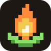

# Emberglade

A cozy top-down voxel survival game that runs in the browser, built with [three.js](https://threejs.org/) and Vite.


Gather, craft, farm and build by day. When night falls it gets cold and gloomlings come out, so light a campfire, put on some armor, or get behind your own walls.

## Features

- **Infinite seeded world** of whole continents and open oceans thousands of tiles across, with deep trenches and broad inland mountain ranges that climb to snowy peaks, one Frozen Wastes region and one Volcanic Lands region per world, and five lowland biomes (Green Meadow, Autumn Woods, Blossom Grove, Pine Forest, Sandy Flats). Everything is generated as you walk and nature regrows over time.
- **Water:** wade through ponds and shallows and swim in deep water, which drains your energy. Dive under the surface on a limited breath of air. Sea water is too salty to drink.
- **The sea floor:** kelp, clams with the odd pearl, coral, and iron ore in the deep. Fish to catch, and snappers that hunt swimmers. A diving mask doubles your air.
- **Vehicles:** a boat to cross open water without tiring, and a submarine that dives, holds its depth, carries its own air and lamp, and keeps sea creatures off you.
- **Gathering and tools:** pick sticks, stones, flowers, fiber and berries by hand; chop trees with an axe; mine stone, coal and copper with a pickaxe.
- **Crafting:** a list of recipes in tabs, each showing what it needs against what you have, with a Craft button (Shift makes 10). More recipes unlock beside a workbench or a campfire. Every item icon is rendered from its own voxel model.
- **See-through cover:** trees and walls between you and the camera thin out around the character, so you never lose sight of them.
- **Farming:** till soil, plant seeds, water them and harvest wheat to bake bread.
- **Survival:** health, food, water and energy bars. Eat, drink at ponds or from a flask, and catch your breath after sprinting.
- **Day and night:** a full sky with sun, moon, stars and clouds, and a gradual dawn.
- **Creatures:** gloomlings, brutes and spitting spitters hunt you after dark; golems guard the mountains at any hour. Fight them with swords, or stay near campfire light.
- **World map:** press M for a full map of the land and sea around you, with your start, bed, vehicles and dropped pack marked.
- **Glider:** jump from a height and glide. **Weather:** real falling rain with splashes and sound, which waters your fields.
- **Harsh regions:** the Frozen Wastes and the Volcanic Lands each lie in one place, marked on the world map. The Frozen Wastes cover a whole stretch of land and the sea beside it, frozen into an ice sheet you can walk across. The sea of the Volcanic Lands boils, and only a submarine can cross it. Going in without fur or crystal gear drains your health fast, and the deeper you go the more pieces you need. Snow falls harder toward the heart of the wastes; ash drifts over the volcanoes.
- **Armor and bags:** woven and copper armor reduce damage and night cold; bags add inventory rows.
- **Base building:** walls, doors, floors, fences, beds and chests, with a placement preview. Creatures cannot cross walls or step on built floors.
- **Hunting and light:** hunt deer for meat and hide, and carry a torch to see at night.
- **Wear and loss:** tools wear out, and fainting leaves your pack where you fell for you to fetch.
- **Minimap** with markers for home, your dropped pack and nearby creatures.
- **Sound and music** synthesised in the browser, with volume sliders.
- **Menu:** worlds, character, settings and controls as tabs, on the title screen and when paused. Three world slots, export / import, volume, and rebindable keys.
- **Character:** choose skin, hair colour and style, shirt and trousers, with a live preview.
- **Twelve keepers:** one boss in every kind of place (each lowland biome, the mountains, the deep sea, the Frozen Wastes and the Volcanic Lands). The world map shows a bearing to each; find the site, bring the right sword and gear, dodge the ground it marks before each blow, and restore its hearth. Each one unlocks a carving, and the twelfth ends the long dusk.
- **Animals:** deer, foxes, boars, hens, rams, hares, grouse and cinder newts, each in its own biomes. They are jointed figures: legs step, heads dip to graze or peck, tails wag, hares bound and newts wriggle. Lead farm animals with wheat, feed a pair inside a closed pen to breed them, and gather eggs and fleece from tame ones.
- **Homestead:** roofs that lift out of view when you step under them, stairs, windows, brick walls and floors, tables, chairs, bookcases, cabinets, lamps and flower boxes. Turnips and pumpkins grow alongside wheat at their own pace, gates close a pen, and a cistern waters the crops beside it.
- **Villages and castles:** every world has villages with houses, a paved square, a hearth and a field, and cliffside castles with a 91-tile outer wall, a six-storey keep and a hoard. Follow the stone stair along the south cliff face to enter the outer ward. Both maps mark them. Villagers stand about the square; press F (or Use) beside one to trade for Glade coins. Farmers, hunters, smiths and traders each buy and sell different things.
- **Enhancing:** creatures drop shards, tusks, venom, fangs and cores, and animals give feathers, wool, bone and hide for leather. The Enhance tab works one of eight effects into the tool or weapon in your hand: poison, fire, chill, life-steal, weight, sharpness, speed or durability.
- **Accounts:** with cloud storage set up, sign in from the Worlds tab to play the same worlds on your phone, tablet and computer.
- **Castle roofing** — At a workbench, turn stone floors and fiber into batches of four slate pieces. For a five-tile tower, lay eave slopes and corners around the outside, middle pieces one row inward, and one upper peak in the centre. Use the rotate control (default `T`) to aim each slope uphill. For a long hall, run a ridge along the centre instead. The castle barracks has a roof you can take apart to study, beds below and storage upstairs. The keep’s lookout has a chart table that locates another settlement.
- **Multi-storey houses:** build up to six storeys. Stairs climb a whole storey the way you face, upper floors rest on what is below, and walls, doors, windows, furniture and roofs go on any storey. Press `[` and `]` (or the Layer buttons on touch) to choose the storey. Indoors, everything overhead lifts out of view. Wood, stone and brick each have walls, floors, stairs and a roof.
- **Built from parts:** boats, submarines and the land-going trail cart are assembled from hulls, oars, propellers and axles.
- **Levels, stats and skills:** earn experience from everything you do, up to level 100. Each level gives a stat point (Vitality, Endurance, Hardiness, Strength, Agility) and every third a skill point for a three-branch tree (Survivor, Explorer, Warrior). Press K for the character sheet.
- **Compass:** a strip across the top shows where the camera looks, with home, your markers and found keepers at their bearings.
- **Map markers:** click the world map, or right click the minimap, to pin up to five markers. Each one stands in the world as a beam of light with a turning gem, and a tag on screen shows the distance and points the way when it is out of view.
- **Harsh-region rewards:** rimeglass and emberglass make the best pickaxe and axe in the game, one-time hoards lie hidden in both regions, and every keeper leaves spoils.
- **Touch and gamepad** controls, a graphics quality setting, and a per-world difficulty.
- **33 guided goals** to learn every system, and autosave in the browser.

## Controls

| Input | Action |
| --- | --- |
| `W` `A` `S` `D` | Move (relative to the camera) |
| `Shift` | Sprint (uses energy); in deep water, dive |
| `Space` | Jump up ledges; under water, swim up |
| Left click | Use tool, pick, harvest, attack |
| Right click | Place, plant, water, wear |
| Right-drag, `Q` / `E` | Turn and tilt the camera; tilt low to look at the sky |
| `R` | Reset the camera |
| Mouse wheel | Zoom |
| `1`–`9` | Select a hotbar slot (drag slots to rearrange) |
| `Tab` | Inventory and crafting |
| `M` | World map (scroll to zoom) |
| `C` | Eat |
| `X` | Drink (next to a pond, or from a flask) |
| `F` | Use a bed, chest, campfire or workbench; get on or off a boat or submarine |
| `Esc` | Pause |

## Run it

Requires [Node.js](https://nodejs.org/) 20 or newer.

```bash
npm install
npm run dev
```

Then open http://localhost:5173. Add `?play` to the address to skip the title menu.

Other scripts:

```bash
npm test        # unit tests for the game rules (Vitest)
npm run build   # production build into dist/
```

## Phones and tablets

Hold the device sideways. The left thumb moves the stick; the right thumb has Tool (hold to keep swinging), Place, Use, Jump and Run. A row of buttons under the compass opens the pack, map and skills, eats and drinks, turns the view and zooms. Tap the ground to aim, drag with two fingers to turn, pinch to zoom.

## Cloud storage (optional)

The game saves in the browser and needs nothing else. To also keep worlds, progress and milestones in your own [Supabase](https://supabase.com) project:

1. Create a project, open the SQL Editor and run [`supabase/schema.sql`](supabase/schema.sql).
2. Turn on Authentication → Sign In / Providers → Anonymous sign-ins.
3. Copy `.env.example` to `.env.local` and fill in the project URL and anon key (Project Settings → API). On Vercel, add the same two variables to the project and redeploy.

Each browser then signs in as an anonymous guest and can only reach its own rows. The Worlds tab shows the connection and has buttons to save to, and load from, the cloud; the game also syncs every few minutes while you play.
## Project layout

- `src/core` – noise functions
- `src/world` – world generation, biomes, object definitions and the layer of player changes
- `src/game` – items, inventory, crafting, goals, survival and all game rules (no rendering, unit tested)
- `src/render` – voxel model builder, models, chunk meshes, sky, characters and effects
- `src/ui` – HUD, inventory and crafting panels, icons
- `tests` – Vitest unit tests
- `docs` – design notes and the screenshot above

## Credits

- Sun and moon sprites from the [Kenney Voxel Pack](https://kenney.nl/assets/voxel-pack) by Kenney (CC0).
- Everything else in the world (terrain, trees, characters, creatures) is built from voxels in code.
