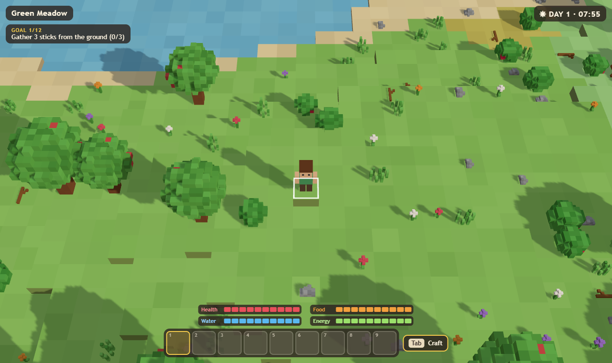

# Emberglade

A cozy top-down voxel survival game that runs in the browser, built with [three.js](https://threejs.org/) and Vite.



Gather, craft, farm and build by day. When night falls it gets cold and gloomlings come out, so light a campfire, put on some armor, or get behind your own walls.

## Features

- **Infinite seeded world** with vast oceans and deep trenches, mountain ranges that climb to snowy peaks, volcanoes with lava-filled craters, frozen wastes with icy ponds, and five lowland biomes (Green Meadow, Autumn Woods, Blossom Grove, Pine Forest, Sandy Flats). Everything is generated as you walk and nature regrows over time.
- **Water:** wade through ponds and shallows and swim in deep water, which drains your energy. Dive under the surface on a limited breath of air. Sea water is too salty to drink.
- **The sea floor:** kelp, clams with the odd pearl, coral, and iron ore in the deep. Fish to catch, and snappers that hunt swimmers. A diving mask doubles your air.
- **Vehicles:** a boat to cross open water without tiring, and a submarine that dives, holds its depth, carries its own air and lamp, and keeps sea creatures off you.
- **Gathering and tools:** pick sticks, stones, flowers, fiber and berries by hand; chop trees with an axe; mine stone, coal and copper with a pickaxe.
- **Grid crafting:** a 2×2 grid by hand and 3×3 at a workbench, with a recipe book that shows every pattern. Campfires smelt copper and cook food.
- **Farming:** till soil, plant seeds, water them and harvest wheat to bake bread.
- **Survival:** health, food, water and energy bars. Eat, drink at ponds or from a flask, and catch your breath after sprinting.
- **Day and night:** a full sky with sun, moon, stars and clouds, and a gradual dawn.
- **Creatures:** gloomlings, brutes and spitting spitters hunt you after dark; golems guard the mountains at any hour. Fight them with swords, or stay near campfire light.
- **World map:** press M for a full map of the land and sea around you, with your start, bed, vehicles and dropped pack marked.
- **Glider:** jump from a height and glide. **Weather:** rain waters your fields.
- **Armor and bags:** woven and copper armor reduce damage and night cold; bags add inventory rows.
- **Base building:** walls, doors, floors, fences, beds and chests, with a placement preview. Creatures cannot cross walls or step on built floors.
- **Hunting and light:** hunt deer for meat and hide, and carry a torch to see at night.
- **Wear and loss:** tools wear out, and fainting leaves your pack where you fell for you to fetch.
- **Minimap** with markers for home, your dropped pack and nearby creatures.
- **Sound and music** synthesised in the browser, with volume sliders.
- **Settings:** rebindable keys, three world slots, and export / import of a world as a file.
- **27 guided goals** to learn every system, and autosave in the browser.

## Controls

| Input | Action |
| --- | --- |
| `W` `A` `S` `D` | Move (relative to the camera) |
| `Shift` | Sprint (uses energy); in deep water, dive |
| `Space` | Jump up ledges; under water, swim up |
| Left click | Use tool, pick, harvest, attack |
| Right click | Place, plant, water, wear |
| Right-drag, `Q` / `E` | Turn and tilt the camera; tilt low to look at the sky |
| `R` | Reset the camera |
| Mouse wheel | Zoom |
| `1`–`9` | Select a hotbar slot (drag slots to rearrange) |
| `Tab` | Inventory and crafting |
| `M` | World map (scroll to zoom) |
| `C` | Eat |
| `X` | Drink (next to a pond, or from a flask) |
| `F` | Use a bed, chest, campfire or workbench; get on or off a boat or submarine |
| `Esc` | Pause |

## Run it

Requires [Node.js](https://nodejs.org/) 20 or newer.

```bash
npm install
npm run dev
```

Then open http://localhost:5173. Add `?play` to the address to skip the title menu.

Other scripts:

```bash
npm test        # unit tests for the game rules (Vitest)
npm run build   # production build into dist/
```

## Project layout

- `src/core` – noise functions
- `src/world` – world generation, biomes, object definitions and the layer of player changes
- `src/game` – items, inventory, crafting, goals, survival and all game rules (no rendering, unit tested)
- `src/render` – voxel model builder, models, chunk meshes, sky, characters and effects
- `src/ui` – HUD, inventory and crafting panels, icons
- `tests` – Vitest unit tests
- `docs` – design notes and the screenshot above

## Credits

- Item sprites, sun and moon from the [Kenney Voxel Pack](https://kenney.nl/assets/voxel-pack) by Kenney (CC0).
- Everything else in the world (terrain, trees, characters, creatures) is built from voxels in code.
